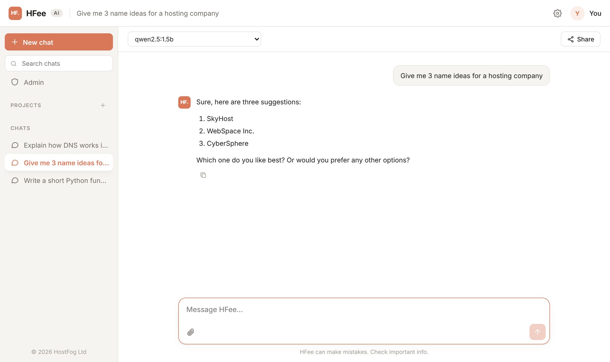

<p align="center">
  
</p>

<h1 align="center">HFee AI</h1>

<p align="center">
  Your own AI assistant. Chat, files, web search, images and voice,<br>
  running on your computer or your server. No API bills, no data leaving your hands.
</p>

<p align="center">
  <a href="https://github.com/hostfog/hfee-ai/releases/latest"></a>
  <a href="LICENSE"></a>
  
</p>

<p align="center">
  <a href="#install">Install</a> ·
  <a href="#features">Features</a> ·
  <a href="#configuration">Configuration</a> ·
  <a href="#troubleshooting">Troubleshooting</a> ·
  <a href="https://github.com/hostfog/hfee">HFee runner</a>
</p>

<p align="center">
  <picture>
    <source media="(prefers-color-scheme: dark)" srcset="docs/chat-dark.png">
    
  </picture>
</p>

By [HostFog Ltd](https://github.com/hostfog). Chat runs on
[HFee](https://github.com/hostfog/hfee), our CPU model runner written in Go,
or on any OpenAI-compatible API.

## Features

| Feature | What it does |
| --- | --- |
| **Chat** | Streaming replies, Markdown, highlighted code, model picker, a queue when the server is busy |
| **Files** | Attach text, code, PDFs and images by clicking, dragging or pasting |
| **Live preview** | HTML and SVG from a reply open in a side panel, with code view and download |
| **Run code** | Python blocks get a Run button; output and charts appear under the code |
| **Web search** | The assistant searches when it needs to and cites numbered sources |
| **Research mode** | Plans several searches, reads the pages and writes a report with sources |
| **Images** | Create images from a prompt, kept in a gallery |
| **Voice** | Speak instead of typing; have replies read aloud |
| **Vision** | Ask about photos and screenshots |
| **Projects** | Shared files and instructions for a group of chats |
| **Memory** | Custom instructions, plus "remember that…" in any chat |
| **Sharing** | Read-only links to a chat |
| **Accounts** | Email sign-in, plans with daily limits, an admin panel for users, models and settings |

Each extra feature switches on when its engine is installed and stays hidden
otherwise. The server installer and the Docker image set all of them up.

## Install

| You want | Use | Time |
| --- | --- | --- |
| AI on your own computer, just for you | [Desktop app](#desktop-app) | 2 minutes |
| A site for you, your team or customers | [Linux server](#linux-server) | 30–60 minutes |
| The same, on a machine that already runs containers | [Docker](#docker) | 20–40 minutes |
| HFee AI on your phone | [Phone](#phone) | 1 minute (after a server) |

---

### Desktop app

Everything runs on your computer: no account, and no internet needed once a
model is downloaded.

**1. Download** the file for your system from the
[latest release](https://github.com/hostfog/hfee-ai/releases/latest):

| System | File |
| --- | --- |
| Windows 10/11 | `hfee-ai-<version>-windows-setup.exe` (or the `.zip` for a portable copy) |
| macOS, Apple silicon | `hfee-ai-<version>-macos-arm64.dmg` |
| macOS, Intel | `hfee-ai-<version>-macos-amd64.dmg` |
| Ubuntu, Debian, Mint | `hfee-ai_<version>_amd64.deb` (or `_arm64.deb`) |
| Other Linux | `hfee-ai-<version>-linux-amd64.tar.gz` |

**2. Install**

- **Windows:** run the setup file. If SmartScreen appears, click
  *More info → Run anyway*.
- **macOS:** open the `.dmg` and drag **HFee AI** into *Applications*. The
  first time, right-click the app and choose *Open* (the app isn't
  notarised yet).
- **Ubuntu/Debian:** `sudo apt install ./hfee-ai_<version>_amd64.deb`, then
  start *HFee AI* from your app menu.
- **Other Linux:** `tar -xzf hfee-ai-*.tar.gz && ./hfee-ai/hfee-ai`

**3. First start.** HFee AI opens in your browser and asks you to download a
model. `qwen2.5:3b` (about 2 GB) is a good first choice; with 16 GB of RAM
or more, try `qwen2.5:7b`. Use **Quit** in the top bar to stop it.

You need 8 GB of RAM for small models and 16 GB for 7B models. Models are
kept in `~/.hfee/models` and shared with the `hfee` command line. Chats are
kept in:

| System | Folder |
| --- | --- |
| Windows | `%AppData%\HFee AI` |
| macOS | `~/Library/Application Support/HFee AI` |
| Linux | `~/.config/hfee-ai` |

**Uninstall:** Windows, *Settings → Apps → HFee AI → Uninstall*; macOS, drag
the app to the Bin; Debian/Ubuntu, `sudo apt remove hfee-ai`. Delete the
folders above to remove your chats and models too.

---

### Linux server

This puts HFee AI online at your own address with HTTPS and sign-in
accounts.

#### What you need

- A server running **Ubuntu 22.04/24.04, Debian 12, Rocky Linux 9,
  AlmaLinux 9, CentOS Stream 9 or Fedora**, with root access.
- A **domain**, such as `chat.example.com`.

| Setup | CPU | RAM | Disk |
| --- | --- | --- | --- |
| Chat only, small model (`--no-engines`) | 4 cores | 8 GB | 20 GB |
| Chat only, 7B model | 8 cores | 16 GB | 30 GB |
| Everything (images, voice, vision, search) | 8+ cores | 32 GB | 60 GB |

HFee runs on the CPU, so no graphics card is needed. More cores and faster
memory mean faster replies.

#### Step 1: point your domain at the server

At your domain provider, add a DNS record:

| Type | Name | Value |
| --- | --- | --- |
| A | `chat` (or `@` for the bare domain) | your server's IP address |

It can take from a few minutes to an hour to work. Check with
`ping chat.example.com`.

#### Step 2: get the server package

Download `hfee-ai-server.tar.gz` from the
[latest release](https://github.com/hostfog/hfee-ai/releases/latest), or build
it yourself (needs Node 22 and Go 1.22):

```bash
git clone https://github.com/hostfog/hfee
git clone https://github.com/hostfog/hfee-ai
cd hfee-ai
HFEE_SRC=../hfee bash deploy/package.sh
```

#### Step 3: copy it to the server and install

```bash
scp hfee-ai-server.tar.gz root@<server-ip>:
ssh root@<server-ip>

tar -xzf hfee-ai-server.tar.gz
bash hfee-ai-server/install.sh --domain chat.example.com --email you@example.com
```

The installer:

1. installs Node.js, Caddy and the firewall rules (SSH, HTTP, HTTPS);
2. installs HFee and the website as system services;
3. downloads the chat model;
4. builds and starts the extra engines: images, voice, vision, web search
   and the Python sandbox (15–30 minutes the first time);
5. requests an HTTPS certificate for your domain.

Installer options:

| Option | Default | |
| --- | --- | --- |
| `--model <name>` | `qwen2.5:7b` | chat model to download |
| `--no-engines` | | chat only; skips images, voice, vision, search and code |
| `--no-signup` | | nobody else can create an account |
| `--daily <n>` | `200` | messages per user per day |
| `--ctx <n>` | `8192` | context window in tokens |

#### Step 4: create your admin account

Open `https://chat.example.com` and create an account. **The first account
becomes the admin.** If the site is just for you, turn off sign-ups in
*Admin → Site* or reinstall with `--no-signup`.

#### Step 5: add more models (optional)

In *Admin → Site*, type a model name and click **Download**. Any model from
the [Ollama library](https://ollama.com/library) works (for example
`llama3.2:3b` or `qwen2.5-coder:7b`), and so does a Hugging Face GGUF repo
(`hf.co/<user>/<repo>:Q4_K_M`). Then tick it under *Models users can pick*.

#### Updating

Download or build a newer package and run the installer again with the same
options. Users, chats, images, models and your `.env` settings are kept.

#### Where things are

| What | Where |
| --- | --- |
| Settings | `/opt/hfee-ai/.env` (then `systemctl restart hfee-ai`) |
| Database | `/var/lib/hfee/site/hfee.db` |
| Created images | `/var/lib/hfee/site/images` |
| Models | `/var/lib/hfee/models`, `/var/lib/hfee/engines` |
| Logs | `journalctl -u hfee-ai -u hfee -f` |
| Services | `hfee`, `hfee-ai`, `hfee-whisper`, `hfee-vision`, `hfee-search` |

Back up `/var/lib/hfee/site` to keep users, chats and images.

#### Uninstall

```bash
sudo bash hfee-ai-server/uninstall.sh           # keeps your data in /var/lib/hfee
sudo bash hfee-ai-server/uninstall.sh --purge   # deletes it too
```

---

### Docker

Needs Docker with Compose (or Podman), and the RAM from the
[server table](#what-you-need).

```bash
git clone https://github.com/hostfog/hfee-ai
cd hfee-ai

echo "SEARXNG_SECRET=$(openssl rand -hex 32)" > .env.docker
docker compose --env-file .env.docker up -d
docker compose logs -f hfee-ai
```

The first start downloads the chat model and the engine models (about 12 GB)
into a volume, so later starts are quick. When the log shows
`HFee AI running`, open <http://localhost:3001> and create the admin account.

Settings go in `.env.docker`:

| Setting | Default | |
| --- | --- | --- |
| `HFEE_TARGET` | `full` | `lite` for chat only (much smaller, no engines) |
| `AI_MODEL` | `qwen2.5:3b` | chat model downloaded on first start |
| `HFEE_PORT` | `3001` | port on the host |
| `DOMAIN` | | your domain, for HTTPS with `--profile https` |
| `ALLOW_SIGNUP`, `DAILY_MESSAGES` | `true`, `200` | accounts and limits |
| `HFEE_NUM_CTX`, `HFEE_NUM_PARALLEL` | `8192`, `4` | context window and replies at once |
| `SD_TYPE` | | `q8_0` to halve image memory on smaller machines |

**HTTPS on a domain:** point the domain at the machine (see Step 1 above),
add `DOMAIN=chat.example.com` to `.env.docker`, then

```bash
docker compose --env-file .env.docker --profile https up -d
```

**Update:** `git pull && docker compose --env-file .env.docker up -d --build`
**Stop:** `docker compose down` (add `-v` to delete all data and models).

---

### Phone

**Install from the browser (no app store):** open your HFee AI site on the
phone, then

- **Android (Chrome):** menu ⋮ → *Install app*
- **iPhone (Safari):** Share → *Add to Home Screen*

It opens full screen with its own icon, like any other app.

**Android and iOS apps:** the [`mobile/`](mobile/README.md) folder builds
real apps for the Play Store and App Store that open your site. Tagged
releases build the Android APK automatically once you set your site address
(see [mobile/README.md](mobile/README.md)).

---

## Configuration

Server settings live in `/opt/hfee-ai/.env` (or `.env` when developing).
Restart with `systemctl restart hfee-ai` after a change. Most day-to-day
settings, such as sign-ups, plans, models and the system prompt, are in the
admin panel instead.

| Setting | Default | |
| --- | --- | --- |
| `AI_BASE_URL` | `http://127.0.0.1:11500/v1` | any OpenAI-compatible API |
| `AI_API_KEY` | | key for that API, if it needs one |
| `AI_MODEL` | | default chat model |
| `ALLOW_SIGNUP` | `true` | allow new accounts |
| `DAILY_MESSAGES`, `DAILY_IMAGES` | `200`, `10` | limits for the default plan |
| `MAX_PARALLEL` | `4` | replies generated at once; others wait in line |
| `SINGLE_USER` | `false` | no sign-in; everyone is the owner (only for private networks) |
| `SYSTEM_PROMPT` | | starting system prompt (can be changed in the admin panel) |
| `PORT`, `HOST` | `3001`, `127.0.0.1` | where the site listens |
| `DB_PATH` | `data/hfee.db` | database file; images are stored next to it |
| `TRUST_PROXY` | `loopback` | which proxies may set the client address |

Engines (the installer writes these for you):

| Setting | Feature |
| --- | --- |
| `VISION_BASE_URL`, `VISION_MODEL`, `VISION_API_KEY` | image understanding |
| `WHISPER_URL` | voice input |
| `PIPER_BIN`, `PIPER_VOICE` | read aloud |
| `SD_BIN`, `SD_MODEL`, `SD_SIZE`, `SD_STEPS`, `SD_CFG`, `SD_SAMPLER`, `SD_SCHEDULER`, `SD_TYPE` | image generation |
| `SEARXNG_URL` | web search |
| `SANDBOX_PYTHON` | running Python |

### Other AI providers

HFee AI works with any OpenAI-compatible API. Set `AI_BASE_URL`, `AI_API_KEY`
and `AI_MODEL` to use Ollama, OpenRouter, Groq or Google Gemini instead of
HFee; [`.env.example`](.env.example) has ready-made blocks for each.

## Engines

All open source, all running on the CPU.

| Feature | Engine | Model (licence) |
| --- | --- | --- |
| Chat | [HFee](https://github.com/hostfog/hfee) | Qwen2.5 7B (Apache 2.0) |
| Vision | [llama.cpp](https://github.com/ggml-org/llama.cpp) | Qwen2.5-VL 3B (Apache 2.0) |
| Images | [stable-diffusion.cpp](https://github.com/leejet/stable-diffusion.cpp) | SDXL-Lightning 4-step (OpenRAIL++) |
| Voice input | [whisper.cpp](https://github.com/ggml-org/whisper.cpp) | Whisper small (MIT) |
| Read aloud | [Piper](https://github.com/OHF-Voice/piper1-gpl) | en_GB Alba (credit the voice) |
| Web search | [SearXNG](https://github.com/searxng/searxng) | none |
| Run code | Python in [bubblewrap](https://github.com/containers/bubblewrap) | no network, 30 s CPU, 1 GB memory |

On a CPU-only server an image takes about a minute, so image requests take
turns. The code sandbox has no network and can't see the rest of the server.

## Troubleshooting

**The site doesn't load over HTTPS.** The DNS record isn't live yet, or ports
80/443 are blocked by your provider's firewall. Check `ping <domain>` shows
your server's IP and run `journalctl -u caddy -n 50`.

**"The model is not responding."** The model is still loading or ran out of
memory. Check `journalctl -u hfee -n 50`, and try a smaller model or a lower
`--ctx`.

**Replies are slow.** CPU speed and memory bandwidth decide it. Use a smaller
model (`qwen2.5:3b`), lower `HFEE_NUM_PARALLEL` if many people chat at once,
or move to a server with more cores.

**Image creation fails on a small server.** Add `SD_TYPE=q8_0` to the `.env`
(or `.env.docker`) to halve its memory use, then restart.

**The engines build failed.** The last 40 lines of the build log are printed;
the full log is in `/opt/hfee-engines/src/<engine>.log`. Run
`bash hfee-ai-server/engines.sh` to try again; finished steps are skipped.

**Locked out of the admin account.** There is no password reset yet. Sign up
with a new email, then make that account an admin on the server:
`sudo sqlite3 /var/lib/hfee/site/hfee.db "UPDATE users SET role = 'admin' WHERE email = 'new@example.com'"`
(install the `sqlite3` package first if the command is missing).

**The desktop app won't start.** Its logs are in the `logs` folder inside the
chat folder for your system ([see above](#desktop-app)).

## Development

```bash
npm install
cp .env.example .env    # point AI_BASE_URL at HFee, Ollama or another API
npm run server          # API on :3001 (Node 22.13+)
npm run dev             # UI on :5173 with hot reload
```

```
src/              React frontend (Vite)
server/           Express API, SQLite, the agent and engine adapters
deploy/           install.sh, engines.sh, uninstall.sh and the server package
docker/           container start script and SearXNG settings
desktop/          desktop launcher (Go) and Windows, macOS and Linux packaging
mobile/           Android and iOS apps (Capacitor)
```

Issues and pull requests are welcome.

## Licence

MIT © 2026 HostFog Ltd. The models and engines above keep their own licences.
